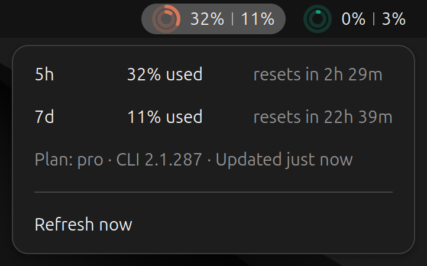

# trai

*trai* = **tray** + **AI**: your AI usage, right in the top bar, and as a CLI.

Your LLM subscription usage at a glance: 5-hour and weekly limits of Claude, Codex and others, as rings in the GNOME top bar and as a CLI for you and your coding agents.


Out of the box, trai shows Claude and Codex. It never reads or stores credentials: the built-in providers ask the `claude` and `codex` CLIs. If either is not installed, it is simply omitted. The outer ring is the 5-hour limit, the inner one the weekly limit (configurable).

Click a ring for details and reset times:



Other models and subscriptions are easy to add: a provider is just a directory with a small script that prints JSON (see [Providers](#providers)). Numbers turn amber or red near the limits, a dot flags a per-model limit, and ⚠ marks a failed refresh or a provider that is not logged in properly:


Refresh times, thresholds, colors, labelling, etc, are all configurable. For example, with names and labels shown (`show_name`, `show_labels`):


## Install

Needs GNOME Shell 46 (Ubuntu 24.04; 47–50 should work but are untested) and Python ≥ 3.11.

```sh
make install     # CLI to ~/.local/bin/trai, extension to ~/.local/share/gnome-shell/extensions
```

The extension appears after your next login; after an update, log out and back in to load the new version. Remove with `make uninstall`.

Sandboxed coding agents can read trai's cache but not refresh it, and the panel stops refreshing while the screen is locked. To keep the data fresh anyway, install a systemd user timer:

```sh
make install-timer   # ticks every 30 s; e.g. INTERVAL=60 for fewer wakeups
```

A tick only fetches when the cache is older than `refresh_seconds`; set that to how fresh agents need the data (e.g. 120). See [docs/agents.md](docs/agents.md).

## Usage

The CLI offers retrieval of usage limits, for instance to give your agents a means of avoiding to stop during a longer task.

```sh
trai status                # usage of all providers
trai status --json         # the same, for scripts
trai check [ID…]           # one line per provider; exit code 0 ok, 1 warn, 2 critical, 3 unknown
trai providers             # discovered providers and their state
trai config init           # write a config template
```

Results are cached during the refresh interval, so repeated calls are instant; `--refresh` forces fresh data.

For coding agents that should stop before running out, see [docs/agents.md](docs/agents.md).

## Config

`trai config init` writes `~/.config/trai/config.toml` with every option commented out at its default: providers and their order, refresh interval, used vs. remaining, thresholds, colours, ring sizes, panel position. Changes show up on the next refresh.

If the panel can't find a CLI that your terminal finds, add its folder to `path`, e.g. `path = ["~/.local/npm/bin"]`.

## Providers

A provider is a directory with a `provider.toml` and an executable `fetch` that prints JSON. Built in: `claude` and `codex`. To add your own or override a built-in one, see [docs/providers.md](docs/providers.md).

## Development

```sh
make test        # unit tests
make dev         # nested GNOME Shell in a window, running this checkout's extension
make screenshots # regenerate docs/screenshots/ in a headless GNOME Shell
```

The design is described in [docs/design.md](docs/design.md).

## Credits

Ideas (no code) from these projects:
[ai-usage-indicator](https://github.com/janpetto/ai-usage-indicator),
[ClaudeCodeUsage](https://github.com/dvdstelt/ClaudeCodeUsage),
[codex-usage-extension](https://github.com/kevinpita/codex-usage-extension),
[gnome-codex-usage-indicator](https://github.com/noah-be/gnome-codex-usage-indicator),
[gnome-claude-usage](https://github.com/laroy-sh/gnome-claude-usage),
[claude-usage-panel](https://github.com/fschmutz/claude-usage-panel),
[ai-usage-stats-gnome](https://github.com/winarmendal/ai-usage-stats-gnome),
[claude-usage-monitor](https://github.com/boergens/claude-usage-monitor).

## License

MIT
